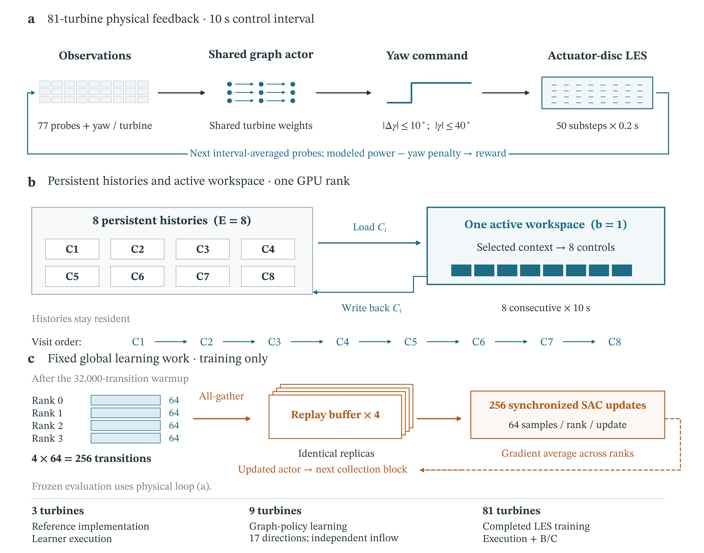

# JAX-WFCOYAW-RL

**GPU-native execution for direct reinforcement-learning training in large-eddy simulation of wind-farm yaw control.**

Research materials for *Scalable execution of direct reinforcement learning in large-eddy simulation for wind farm yaw control* by Zhuang Shao, Jiamei Yang, Lijun Lei, Bingnan Li, Ruifeng Ding and Zhenlong Wu. The manuscript is intended for **Wind Energy**; no publication or DOI is claimed here.

The execution method separates persistent turbulent-flow histories, reusable active flow workspace and synchronized global learning. This permits continuing LES histories to be advanced in sequential microbatches while retaining a shared graph soft actor–critic learner. The primary demonstration is a completed million-interaction training run for an **81-turbine farm** on four H20 GPUs.



*Execution method: continuing physical histories share an active LES workspace and synchronized global learning. The lower strip identifies the separately trained case roles. Original author-generated figure, [CC BY 4.0](LICENSES/CC-BY-4.0.txt); the release preserves the scientific-artifact image bytes without redrawing.*

## Start here

- **Browse the scientific code:** [science/README.md](science/README.md) and [science/SOURCE_INDEX.json](science/SOURCE_INDEX.json).
- **Obtain the fixed research materials:** [v1.0.0 release](https://github.com/VickylastShao/JAX-WFCOYAW-RL/releases/tag/v1.0.0).
- **Verify records and rebuild plots:** [reproducibility guide](docs/REPRODUCIBILITY.md).
- **Understand simulation starts and rerun requirements:** [simulation-state guide](docs/STATE_FILES.md).
- **Check licences and attribution:** [licensing guide](docs/LICENSING.md), [third-party notices](THIRD_PARTY_NOTICES.md) and [CITATION.cff](CITATION.cff).

The browsable `science/` tree mirrors 210 indexed files from the amended portable scientific archive. The [source index](science/SOURCE_INDEX.json) binds every file to its current archive member and SHA-256. Historical machine paths and packaging references have been made portable; the accompanying amendment record identifies these metadata changes. Scientific numerical records and results are retained. This is a navigation mirror, not a separately packaged training environment. Use the release archive for complete analysis inputs, manifests and execution instructions.

## What each case establishes

| Case | Scientific role | Interpretation |
|---|---|---|
| **3 turbines** | Reference LES–SAC task and implementation checks | Establishes the reference-task bridge and separates learner throughput from complete physical training cost. |
| **9 turbines** | Intermediate graph-policy learning across fixed directions | Demonstrates positive modeled energy gains on an independent inflow source. The static LES lookup controller has a **higher mean gain** under the reported evaluation protocol; all controller results are retained. |
| **81 turbines** | Farm-scale execution design and control outcome | Tests workspace reuse and GPU allocation, completes direct LES training, and evaluates the frozen final policy on independently seeded B/C turbulent sources. |

These are separately trained tasks, not a transfer-learning sequence or a controlled scaling law. See [case roles and evidence boundaries](docs/CASE_ROLES.md).

## Versioned release contents

Manuscript identifiers inside scientific snapshot metadata refer to the archived scientific edition; current submission files are maintained separately.

The `v1.0.0` release layout separates the following artifacts:

| Artifact | Content |
|---|---|
| `n81_20261018_portable_science.tar.gz` | Scientific code, saved numerical records, trained actors, computational profiles, figure inputs/exports, manifests and CPU/plotting entry points. |
| Eleven compressed simulation starting states | Three qualified turbulent source states and eight B/C common-state evaluation starts, supplied as separate release assets. |
| `SHA256SUMS-portable-20261018.txt`, `SHA256SUMS-inputs.txt`, `INPUTS_MANIFEST.json` | Archive integrity, per-state integrity and the mapping from public asset names to original scientific records. |

The scientific archive is **371,131,482 bytes**, with SHA-256:

```text
12eb6a9162a9998ed920499b06a7d0045ec41bb07510771b25fd4fa757e707f6
```

The eleven state assets total **7,177,998,200 compressed bytes**, separate from the scientific archive. The original Docker image, full training-resume states, complete inlet histories, manuscript TeX/full-paper PDFs and private submission materials are outside this public release.

## Reproduce the saved-record analysis

Download the scientific archive and its SHA-256 sidecar from the release, verify them, then extract on Linux-native storage. In WSL, prefer the Linux home directory or `/tmp` over a mounted Windows drive.

```bash
sha256sum -c n81_20261018_portable_science.tar.gz.sha256
tar -xzf n81_20261018_portable_science.tar.gz
cd n81_20261018_portable_science
python3 verify_package.py

python3.12 -m venv "$HOME/wind-energy-cpu"
"$HOME/wind-energy-cpu/bin/python" -m pip install -r requirements-cpu.txt
"$HOME/wind-energy-cpu/bin/python" -B run_cpu_acceptance.py --workdir /tmp/wind-energy-v1-check
```

Choose a new external work directory. The CPU suite runs **16 saved-record checks**; success requires `status=complete`, `exit_code=0` and `CPU_command_count=16`. It performs no LES integration, actor inference or training.

A separate plotting environment can rebuild **seven figure groups** from the archived inputs. See [the full guide](docs/REPRODUCIBILITY.md). The archive retains all **18 groups / 54 formal PDF, SVG and PNG exports**. Cross-platform byte-identical graphics are not promised.

## Interpretation and reuse

The principal contribution is an execution method for direct LES training at farm scale. The reported **42.03×** comparison concerns compiled learner blocks against a locally configured host-synchronizing TorchRL 0.3.1 learner benchmark; it excludes LES and is not an end-to-end training speedup. B/C gains concern modeled gross energy for two independently seeded turbulent sources in one nominal wind regime, with dependent windows within each source.

The saved records support numerical reanalysis and plot reconstruction. Starting states preserve physical source/evaluation initial conditions; full-window LES reruns also require the subsequent inlet histories and a matching runtime. The historical 80 s replay checks a prefix. Complete training restart and cross-hardware bitwise physical reconstruction are not established by this release.

Author-owned code is distributed under **MIT**; author-generated data, actors and figures under **CC BY 4.0**. Third-party materials retain their own notices. The preserved historical code-copyright line and the current six-author research citation serve different purposes; see [licensing and authorship](docs/LICENSING.md).

To cite this version, use [CITATION.cff](CITATION.cff) and the release version. No journal-publication metadata or DOI should be inferred from this repository.
